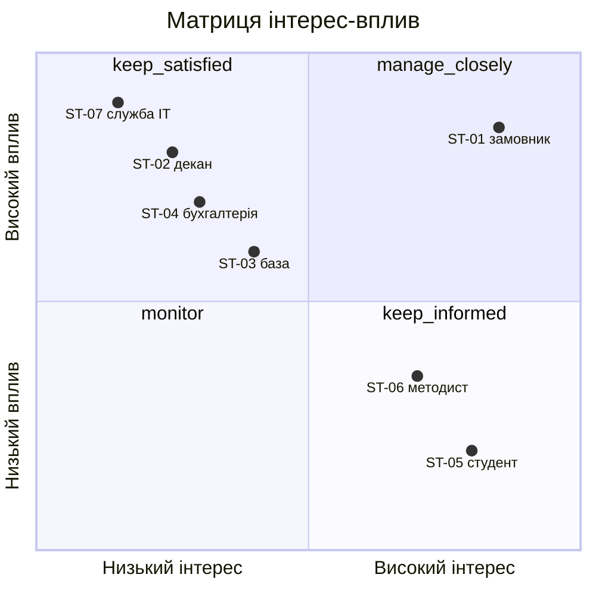

# Статут проєкту

Студент: Соболюк Назарій, `Nryyy`. Тема: Платформа обліку практик і стажувань:
студент, база практики, керівник, звіти. Варіант вхідних умов: V03.

## 1. Навіщо цей проєкт

Проблема замовника: керівник практики від факультету щороку веде близько сотні
студентів (контекст теми), і кожен приносить пакет паперів: направлення, договір
з базою, щоденник і звіт, тобто близько 400 документів за рік (моє припущення: 4
документи на студента). Стан здачі зводиться вручну в таблицю, яка завжди
відстає на тиждень (контекст теми), тож хто що не здав, з'ясовується наприкінці
семестру, коли дати звітності вже не зсунути. На саме зведення керівник
витрачає близько 5 годин на тиждень у сезон практики (моє припущення).

Мета проєкту: керівник практики пілотного факультету в будь-який день бачить, хто
з його студентів що здав, без ручного збору, а керівник від бази ставить оцінку
без акаунта в академії.

## 2. Business case: чому саме це рішення

Ціна людино-тижня: бюджет 1 600 000 грн / (5,0 FTE × 16 тижнів = 80 людино-тижнів)
= 20 000 грн за людино-тиждень, або 500 грн за годину.

| Варіант | Що це | Витрати | Вигоди | Ризики |
| :-: | --- | --- | --- | --- |
| A | Купити готову систему управління практиками з впровадженням | 8 люд.-тиж. (160 000 грн) на налаштування; назовні 250 000 грн впровадження + 400 000 грн/рік підписка. Перший рік 810 000 грн, за три роки 1 610 000 грн | запуск за 8 тижнів, перевірені процеси, підтримка постачальника | оцінка від бази без акаунта не гарантована і може вимагати платного допрацювання; щорічна оренда; шаблони документів не українські |
| B | Зробити свою платформу (пілот на одному факультеті) | 80 люд.-тиж. (1 600 000 грн); назовні 0 грн, хостинг на серверах академії | закриває обидві вимоги замовника; без ліцензійних платежів після релізу; процес під договір і бухгалтерію академії | використовує весь бюджет і весь строк; підтримка після релізу лягає на академію; залежність від служби ІТ щодо сервера |
| C | Мінімальне своє поверх документообігу загального призначення (форми + зведена таблиця) | 16 люд.-тиж. (320 000 грн); назовні 60 000 грн/рік підписка | найдешевший робочий варіант, готовий за 8 тижнів | зведення лишається напівручним; базам потрібні акаунти або обхідні форми; контролю договору перед стартом немає |
| D | Нічого не робити | 0 грн | жодних витрат і змін для методиста кафедри | лишаються 5 годин на тиждень ручної роботи і тиждень відставання; пропущені звіти виявляються наприкінці семестру |

Звідки взялися числа:

| Число | Звідки |
| --- | --- |
| 250 000 грн впровадження і 400 000 грн/рік підписки для A | моє припущення: постачальники класу «placement management» ([InPlace](https://www.g2.com/products/inplace/discuss), [INTO від Funidata](https://funidata.fi/en/services/into)) ціни не публікують і дають їх за запитом; орієнтир згори: модуль CRM [Ellucian](https://zoftwarehub.com/en-ae/products/ellucian/pricing) для вишу на 2 000 студентів коштує 30-50 тис. фунтів на рік, а нам потрібен один факультет |
| 8 люд.-тиж. для A | PM 50% і BA 50% протягом 8 тижнів на налаштування і перенесення шаблонів |
| 80 люд.-тиж. для B | склад V03: PM 0,5 + BA 0,5 + Dev 1 + Dev 1 + Dev 1 + QA 1 = 5,0 FTE × 16 тижнів |
| 16 люд.-тиж. для C | PM 0,5 + BA 0,5 + Dev 1 = 2,0 FTE × 8 тижнів |
| 60 000 грн/рік для C | моє припущення: близько 5 000 грн на місяць за тариф документообігу з формами для однієї кафедри |
| 5 годин на тиждень для D | моє припущення: 100 студентів, близько 400 паперів за сезон, звірка з таблицею вручну |

Рекомендація: варіант B. Тільки він закриває обидві вимоги замовника (стан здачі
в будь-який день і оцінка від бази без акаунта) і при цьому вкладається в бюджет
1 600 000 грн і строк 16 тижнів. A за три роки коштує стільки ж (1 610 000 грн),
але це оренда, а ключова вимога про оцінку без акаунта не гарантована. C утричі
дешевший, але лишає зведення напівручним, тому критерії SC-01 і SC-04 на ньому не
досягаються.

Що зміниться в рішенні, якщо бюджет вашого варіанта зменшити вдвічі: на
800 000 грн припадає 40 людино-тижнів, і повна платформа B не вміщується. Тоді
обираю C (320 000 + 60 000 грн) плюс власний невеликий модуль оцінювання від
бази за посиланням (близько 16 люд.-тиж., 320 000 грн), разом близько 700 000 грн,
а автоматичне зведення стану здачі виходить за межі першого релізу.

## 3. Обсяг

Що робимо:

- Облік студентів пілотного факультету, баз практики і закріплення студента за базою на семестр.
- Електронне подання чотирьох документів практики (направлення, договір, щоденник, звіт) зі статусами.
- Зведення для керівника практики: хто що здав на сьогодні.
- Оцінювання від керівника бази за персональним посиланням без акаунта.
- Вхід і ролі: студент, керівник практики від факультету, адміністратор.
- Статус «договір підписано» для бухгалтерії до старту практики.
- Пілот на одному факультеті з одним сезоном практики.

Чого не робимо в цьому проєкті:

- Мобільний застосунок: працюємо тільки в браузері. Причина: не вміщується в строк 16 тижнів поруч з основним обсягом.
- Підписання договорів кваліфікованим електронним підписом: договір підписується на папері, у систему завантажується скан. Причина: інтеграція з КЕП не вміщується в бюджет і строк.
- Автоматичний імпорт студентів із системи деканату: список завантажується файлом. Причина: не потрібно для мети, а залежність від деканату на ЛР3 показала тиждень очікування.
- Розгортання на всю академію: тільки один пілотний факультет. Причина: не вміщується в строк, і масштабування вирішуємо за даними пілоту, а не наперед.
- Каталог вакансій стажувань і підбір компаній для студентів. Причина: не потрібно для мети, замовник просить облік, а не пошук місць.

## 4. Обмеження з мого варіанта

| Обмеження | Значення варіанта V03 | Що з нього випливає для плану |
| --- | --- | --- |
| Строк до першого релізу | 16 тижнів | вісім двотижневих спринтів і один реліз для пілоту; реліз має випередити старт практики за графіком, тому при нестачі часу ріжемо обсяг, а не зсуваємо дату |
| Склад команди | PM 50%; BA 50%; Dev 100% × 3; QA 100% (5,0 FTE) | стеля 3 200 годин; BA на пів ставки, тому вимоги бухгалтерії і баз збираємо в перших двох спринтах; QA на повну ставку тестує в кожному спринті, а не наприкінці |
| Бюджет прямих витрат | 1 600 000 грн | 500 грн за годину команди, і весь бюджет іде на склад; на ліцензії, КЕП чи платний хостинг грошей немає, тому хостинг на серверах академії |

Припущення, на яких тримаються ці числа: керівник практики приходить на демо раз
на два тижні; служба ІТ дає сервер і погоджує обробку персональних даних протягом
першого місяця; факультет передає список студентів файлом за перші два тижні;
у кожної бази є електронна пошта, і посилання на оцінювання вона відкриє.

Підхід, з яким цей статут не сперечається: adaptive (Scrum із двотижневими
спринтами в межах 16 тижнів), бо дата практики фіксована, а вимоги баз і
бухгалтерії уточнюються на демо.

## 5. Критерії успіху

Звідки цільові числа:

- SC-01: замовник хоче бачити стан «у будь-який день»; 5 хвилин на обробку
  завантаження це технічний запас, і він у тисячі разів менший за поточний тиждень.
- SC-02: 80%, а не 100%, бо бази різні за готовністю щось заповнювати онлайн
  (контекст теми); решта оцінок приходить на папері і вноситься вручну.
- SC-03: 0, бо вимога бухгалтерії абсолютна; базового значення немає, бо зараз
  це з'ясовується вже після старту.
- SC-04: година на тиждень лишається на розбір винятків; базові 5 годин це моє
  припущення, і першим кроком пілоту його треба заміряти.
- SC-05: 90%, бо частина баз може не дати студенту змоги завантажити щоденник
  вчасно; число перевіряється на пілоті.

Критерій, за який буде найважче відзвітувати: SC-02. Він залежить від баз
практики, які проєкту не підпорядковані, а виміряти його можна тільки після
закриття пілотної практики, тобто вже після релізу.

## 6. Стейкхолдери

| Квадрант | Хто туди потрапив | Стратегія на практиці |
| --- | --- | --- |
| Високий інтерес, високий вплив | ST-01 | щотижневий 30-хвилинний синк і демо кожні два тижні; зміни обсягу вирішуються з ним |
| Низький інтерес, високий вплив | ST-02, ST-03, ST-04, ST-07 | ST-07: зустріч на першому тижні щодо сервера і персональних даних, далі погодження перед кожним розгортанням; ST-04: погоджуємо статус «договір підписано» у другому спринті, далі лист при зміні; ST-03: інструкція на одну сторінку і перевірка посилання з двома-трьома базами в четвертому спринті; ST-02: короткий лист-статус раз на місяць і запрошення на демо релізу |
| Високий інтерес, низький вплив | ST-05, ST-06 | ST-06: участь у тестуванні раз на два тижні з третього спринта; ST-05: оголошення через кураторів перед стартом пілоту і форма зворотного зв'язку |
| Низький інтерес, низький вплив | — | — |

Спірні розміщення: ST-03, керівник від бази. Кожна база окремо майже не впливає
на проєкт, тож її можна було б покласти в «низький вплив». Але всі разом вони
вирішують, чи виконається SC-02, тому я поставив їм високий вплив. Другий спірний
— ST-06, методист кафедри: формально впливу він не має, але може тихо зірвати
пілот, якщо й далі прийматиме папери. Поки лишаю його в «низькому впливі» і
стежу за ним через участь у тестуванні.

Хто може зупинити проєкт: ST-07. Без виділеного сервера і погодження обробки
персональних даних студентів платформу неможливо розгорнути в академії, а
бюджету на зовнішній хостинг немає.

## 7. Робочий журнал

Спершу у варіанті B я заклав платний хостинг назовні, і B виходив за бюджет
1 600 000 грн. Перенесення хостингу на сервери академії повернуло B в бюджет,
але зробило службу ІТ (ST-07) стейкхолдером, який може зупинити проєкт. Бази
практики спочатку стояли в квадранті «спостерігати», а перемістив я їх тоді,
коли записав SC-02 і побачив, що без них він не виконується.
