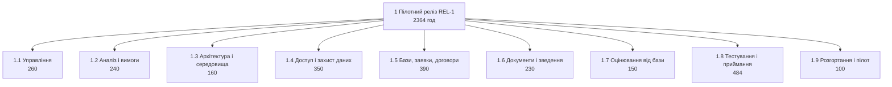

# WBS, календарний план і дорожня карта

Студент: Соболюк Назарій, `Nryyy`. Тема: Платформа обліку практик і стажувань:
студент, база практики, керівник, звіти. Варіант вхідних умов: V03.

Декомпозиція лежить у `wbs.csv`, роботи і залежності в `schedule.csv`, релізи в
`roadmap.csv`. Нижче те, чого таблиці не вміщують.

Файли відображають план після події курсу від 2026-10-20 (лист служби
інформаційної безпеки, `lr11_risks_quality/README.md`, розділ 5). Числа першої
версії плану, де вони потрібні для порівняння, наведено поруч.

## 1. Стеля годин мого варіанта

| Роль | Зайнятість | Годин до релізу | Скільки взяв у WBS |
| --- | :-: | ---: | ---: |
| PM | 50% | 320 | 280 |
| BA | 50% | 320 | 280 |
| Dev × 3 | 100% | 1 920 | 1 320 |
| QA | 100% | 640 | 484 |
| **Разом** | 5,0 FTE | **3 200** | **2 364** |

Розрахунок: 5,0 FTE × 16 тижнів × 40 годин на тиждень дає 3 200 годин команди до
першого релізу. У корені `wbs.csv` стоїть 2 364 години, тобто 74% стелі (до події курсу
2 474 години, 77%). Колонку
«Скільки взяв» я рахував по листових вузлах за полем `owner`.

Чому саме стільки. Решта 836 годин це не вільний час, а плата за залежності.
Розробники чекають один одного на стиках історій, а критичний шлях лишає лише чотири
дні запасу до строку (до події курсу два). Додаткові години на цьому шляху календарних днів не
додають. Тому запас лишається некерованим резервом під уточнення вимог
бухгалтерії і баз, які статут прямо називає невизначеними. На ЛР16 з цього
резерву вийде contingency. Найщільніше завантажена роль це BA: її роботи в плані
стоять ланцюгом на 76 днів із 76 і після події курсу лежать на критичному шляху.

## 2. Правило 100%: як перевіряли

Спосіб перевірки складався з двох кроків.

- **Згори вниз.** Кожна з 12 історій REL-1 у `backlog.csv` має свій листовий вузол
  у 1.4–1.7. S-15 розділена на два вузли, 1.7.1 і 1.7.2, бо посилання і форму
  роблять різні люди в різний час. Історій без вузла немає, а вузлів розробки без
  історії немає, крім технічної основи 1.3.
- **Знизу вгору.** Суму дітей кожного батька порахував скриптом, валідатор
  повторює цю перевірку (WBS-3). Потім розклав години листків за ролями і звірив
  їх зі стелею кожної ролі окремо, а не тільки з підсумком: PM 280 ≤ 320,
  BA 280 ≤ 320, Dev 1 320 ≤ 1 920, QA 484 ≤ 640.

Робота, яку ледь не забули: погодження сервера і обробки персональних даних зі
службою ІТ (1.9.1). Перша версія WBS мала розгортання тільки як роботу
розробника. Цей пункт я згадав, коли перечитував припущення статуту: «служба ІТ
дає сервер і погоджує обробку персональних даних протягом першого місяця». Без
цього погодження розгортати нікуди, а реальні дані студентів у систему завантажувати
не можна. Слідом за ним з'явився і пункт 1.9.3 «Завантаження даних пілоту»: це
окрема робота BA, а не побічний ефект імпорту S-17.

Що свідомо поза обсягом:

- Мобільний застосунок. Працюємо тільки в браузері, бо застосунок не вміщується в 16 тижнів.
- Підписання договорів через КЕП. Договір підписується на папері, у систему потрапляє скан (1.5.5).
- Автоматичний імпорт студентів із системи деканату (S-09). Список завантажується файлом (1.4.2).
- Розгортання на всю академію. Пілот іде на одному факультеті.
- Каталог вакансій стажувань і підбір компаній.
- Історії поза REL-1, а саме S-07, S-10, S-12, S-13. Їх немає в цій WBS: вона описує роботу до першого релізу. S-02 і S-09 мають клас `wont` і не плануються зовсім.

Список збігається з розділом «Чого не робимо» статуту. Останній пункт статут не
містить, бо він про межу релізу, а не проєкту.

## 3. Тривалості: звідки взялися числа

Днів = годин ÷ (8 × кількість людей × зайнятість), округлення вгору.

| Робота | Годин | Хто робить і на скільки відсотків | Днів |
| :-: | ---: | --- | ---: |
| T-06 (S-01) | 120 | 2 Dev по 100% | 8 |
| T-07 (S-11) | 100 | Dev 100% | 13 |
| T-10 (S-03) | 120 | 2 Dev по 100% | 8 |
| T-12 (S-05) | 80 | 2 Dev по 100% | 5 |
| T-36 (S-20) | 80 | Dev 100% | 10 |
| T-15 (S-14) | 110 | Dev 100% | 14 |
| T-20 (S-15, посилання) | 70 | Dev 100% | 9 |
| T-21 (S-15, форма) | 80 | 2 Dev по 100% | 5 |
| T-19 (вимоги баз) | 50 | BA 50% | 13 |
| T-27 (регресія) | 64 | QA 100% | 8 |

Де тривалість не виводиться з годин:

- **T-02, вимоги бухгалтерії і шаблон угоди:** 60 годин BA на 50% дають 15 днів, а в плані стоїть 20. Шаблон угоди дає бухгалтерія, а на ЛР6 S-04 вже не пройшла DoR саме через нього. П'ять днів закладено на очікування відповіді. Після події курсу S-04 пішла в REL-2, але T-02 лишилась: від бухгалтерії потрібне правило статусу «підписано» для S-16.
- **T-05, погодження сервера і персональних даних:** 20 годин PM, а тривалість 20 днів. Це майже весь час чекання на службу ІТ: статут дає їй перший місяць.
- **T-25, функціональне тестування:** 320 годин QA це 40 днів роботи, але в плані 50. QA тестує кожну історію, щойно вона готова, тож робота розтягнута на всі спринти.
- **T-31, Scrum-події і комунікація:** 200 годин PM розподілені на 65 днів. Це теж робота рівня зусиль, вона триває стільки, скільки триває розробка.

## 4. Критичний шлях

Дата старту робіт: 2026-10-12, це старт спринта 1 з `lr03_sprint_simulation/sprints.md`.
Тиждень це п'ять робочих днів, свята не рахуємо.

| Що | Значення |
| --- | --- |
| Критичний шлях, робочих днів | 76 (до події курсу 78) |
| Ланцюг критичних робіт | T-03 → T-24 → T-25 → T-26 → T-27 → T-29 → T-33 (тестування) і T-02 → T-19 → T-34 → T-22 → T-23 → T-28 → T-29/T-30 → T-33 (ланцюг BA); паралельно критична T-27 → T-32 → T-33 |
| Дата завершення за планом | 2027-01-25; `target_date` REL-1 у `roadmap.csv` лишається 2027-01-27, яку план давав до події курсу і яку спонсор не рухає |
| Строк мого варіанта, робочих днів | 16 × 5 = 80 (2027-01-29) |
| Різниця | 76 − 80 = −4 |

Чи вкладаємось: так, із запасом у чотири дні (до події курсу було два). Свят у розрахунку немає, а
між датами плану лежать новорічні. Якщо команда реально бере вихідні з 1 по 7
січня, календарно це вже мінус три дні і строк зірвано.

Що з цим робимо. Дату релізу не рухаємо, бо реліз має випередити старт практики
(статут, розділ 4), а спонсор після події курсу прямо сказав, що дата не
рухається. Тому при зсуві ріжемо обсяг. Порядок різання, заданий на ЛР6
(S-08, S-18, S-04), уже використано на обмін під вимоги служби ІБ: ці три історії
пішли в REL-2. Наступний кандидат це скорочена S-21: сторінка з переліком даних
без тих строків зберігання, які служба ІБ ще не погодила. Після події критичним
став ланцюг BA, бо вимоги служби ІБ (T-34) лягли на ту саму людину на пів ставки.
Тому друге рішення стосується людей, а не обсягу: якщо T-34 або T-22 зсунеться
більш ніж на два дні, частину уточнення історій (T-22) бере на себе PM, у якого
на T-31 є резерв.

Робота з найбільшим резервом: T-05 (погодження сервера і обробки персональних
даних), 14 днів. Резерв тут зібрався тому, що розгортання (T-13) і вхід через
акаунт академії (T-35) потрібні пізніше, ніж служба ІТ має відповісти. Це резерв
на ризик: T-05 залежить від служби ІТ, яку проєкт не контролює, і після події від
неї ж залежить доступ до акаунтів академії (ризик R-01 у ЛР11).

## 5. Віхи

| Віха | Що саме перевіряється в цій точці | Резерв |
| --- | --- | ---: |
| T-11, 2026-11-23 | Наскрізний сценарій студента на тестовому середовищі: вхід під роллю, вибір бази з переліку, заявка зі статусом, на імпортованих із CSV студентах | 3 |
| T-26, 2027-01-06 | Функціональна повнота: усі 12 історій REL-1, разом із трьома вимогами служби ІБ, пройшли функціональне тестування, нових функцій після цієї точки не додаємо | 0 |
| T-33, 2027-01-25 | Керівник практики підписав протокол приймання (T-29), служба ІБ підтвердила три пункти листа (SC-06), дані пілоту завантажені, звіт про реліз здано | 0 |

T-26 і T-33 лежать на критичному шляху: зсув будь-якої на день зсуває REL-1 на
день. T-11 після події курсу отримала три дні резерву, бо розробка перестала бути
найдовшим ланцюгом. Але це досі перша точка рішення: якщо до 2026-11-23
наскрізний сценарій не працює, наступний кандидат із розділу 4 ріжемо одразу, а
не в січні.

## 6. Дорожня карта

| Реліз | Історії з беклогу | Чому нарізано саме так |
| :-: | --- | --- |
| REL-1 | 12 історій з епіків Доступ, Практика, Звіти, Адміністрування: S-01, S-03, S-05, S-06, S-11, S-14, S-15, S-16, S-17, S-19, S-20, S-21 | Усе, що потрібно для мети статуту, критеріїв SC-01…SC-05 і приймання службою ІБ (SC-06). До події курсу в REL-1 були S-04, S-08 і S-18 замість S-19, S-20 і S-21 |
| REL-2 | 7 історій: S-04, S-18, S-08, S-07, S-10, S-13, S-12 (епіки Практика, Звіти, Інтеграції, Адміністрування) | Те, що прибирає ручну роботу кафедри після пілоту: угода за шаблоном, перелік без договору, нагадування, оцінка звіту, зведення в таблицю, правка шаблону угоди, звіт по семестру. Перші три винесено з REL-1 за подією курсу. S-02 і S-09 у REL-2 не йдуть: обидві мають клас `wont`, бо суперечать статуту (база без акаунта, імпорт із деканату поза обсягом) |

Склад релізів живе в колонці `release` файла `backlog.csv`. `REL-2` я дописав туди
під час цієї роботи. Принцип такий: у REL-2
йдуть історії, які стоять у черзі одразу за REL-1 (ранги 13–19), а `wont`-історії не йдуть нікуди.
Тому правило BL-8 не порушується.

Що фіксовано в першому релізі: дата. Реліз має випередити старт практики, а
пізній реліз означає ще один сезон на папері. Обсяг змінний, і порядок, у якому
ми його ріжемо, заданий наперед (розділ 4).

Точність дати REL-2: 2027-05-31 це орієнтир на кінець весняного семестру, а не
зобов'язання. Дату буде переплановано після пілоту за даними фактичної velocity
з ЛР9, і точність у ±1 місяць відповідає горизонту в пів року.

## 7. Робочий журнал

Перша версія календарного плану дала 116 робочих днів проти 80. Кожну історію
там робив один розробник, а залежності я ставив «за змістом». Три зміни
повернули план у строк:

1. **Залежність, яка виявилась вигаданою.** У першій версії форма оцінки від
   бази (S-15) чекала на перелік студентів без договору (S-18), бо обидві «про
   кінець практики». Насправді посилання для бази потребує тільки закріплення і
   угоди. Після зняття зв'язку S-15 переїхала з кінця ланцюга на паралельну гілку.
2. **Залежності, які виявились ресурсними обмеженнями.** Коли я порахував
   завантаження розробників по днях, на днях 20–23 їх виходило четверо при
   трьох у команді. Частина зв'язків у `schedule.csv` тепер не змістовна, а
   ресурсна. Наприклад, T-13 (розгортання) стоїть після T-09 (S-06), бо його
   робить той самий розробник. Так само всі роботи BA стоять ланцюгом, бо BA одна
   людина на пів ставки.
3. **Пакети, які довелося робити парою.** S-01, S-03, S-05 і форма S-15 лежали
   на критичному шляху самі по собі, тому кожну з них тепер роблять два
   розробники. Заодно я переглянув оцінки п'яти пакетів у бік зменшення
   (S-01, S-04, S-06, S-14, розгортання, разом −120 годин) і скоротив
   регресію з 13 до 8 днів. Частина регресії переїхала у функціональне
   тестування в спринтах.
4. **Подія курсу, 2026-10-20.** Під три вимоги служби ІБ у WBS з'явились вузли
   1.2.5, 1.4.3, 1.4.4 і 1.4.5 (170 годин), а вузли винесених історій 1.5.4
   (S-04), 1.5.6 (S-18) і 1.6.3 (S-08) прибрано разом із роботами T-14, T-17 і
   T-18 (280 годин). Нові роботи T-34…T-37 спершу перевантажили розробників на
   днях 36–52, тому вхід через акаунт академії (T-35) поставлено після посилань
   S-15 (T-20), а сторінку про дані (T-37) після форми оцінки (T-21). Обидва
   зв'язки ресурсні. Критичний шлях скоротився з 78 до 76 днів, але переїхав із
   розробки на тестування і ланцюг BA.

Ще одна знахідка про ціль спринта 1 у `sprints.md`: вхід, перелік баз і подання
заявки за два тижні. За оцінками цієї WBS ця ціль не вміщується в спринт, бо
план дає наскрізний сценарій студента тільки до 2026-11-23 (віха T-11), тобто
на стику спринтів 3 і 4. Проте спринт 1 закрив усі три історії за 10 робочих
днів. Отже, або пакети 1.4.1, 1.5.1 і 1.5.2 у WBS оцінені із запасом, або «готово»
у спринті 1 було тоншим за пакети WBS. Перевірю це на спринті 2: якщо і він
закриє все взяте, оцінки годин розробки у WBS переглядаю вниз.
