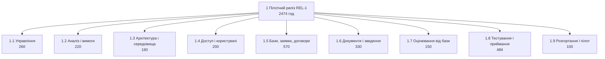

# WBS, календарний план і дорожня карта

Студент: Соболюк Назарій, `Nryyy`. Тема: Платформа обліку практик і стажувань:
студент, база практики, керівник, звіти. Варіант вхідних умов: V03.

Декомпозиція лежить у `wbs.csv`, роботи і залежності в `schedule.csv`, релізи в
`roadmap.csv`. Нижче те, чого таблиці не вміщують.

## 1. Стеля годин мого варіанта

| Роль | Зайнятість | Годин до релізу | Скільки взяв у WBS |
| --- | :-: | ---: | ---: |
| PM | 50% | 320 | 280 |
| BA | 50% | 320 | 260 |
| Dev × 3 | 100% | 1 920 | 1 450 |
| QA | 100% | 640 | 484 |
| **Разом** | 5,0 FTE | **3 200** | **2 474** |

Розрахунок: 5,0 FTE × 16 тижнів × 40 годин на тиждень дає 3 200 годин команди до
першого релізу. У корені `wbs.csv` стоїть 2 474 години, тобто 77% стелі. Колонку
«Скільки взяв» я рахував по листових вузлах за полем `owner`.

Чому саме стільки. Решта 726 годин це не вільний час, а плата за залежності.
Розробники чекають один одного на стиках історій, а критичний шлях лишає лише два
дні запасу до строку. Додаткові години на цьому шляху календарних днів не
додають. Тому запас лишається некерованим резервом під уточнення вимог
бухгалтерії і баз, які статут прямо називає невизначеними. На ЛР16 з цього
резерву вийде contingency. Найщільніше завантажена роль це BA: її роботи в плані
стоять ланцюгом на 71 день із 78.

## 2. Правило 100%: як перевіряли

Спосіб перевірки складався з двох кроків.

- **Згори вниз.** Кожна з 12 історій REL-1 у `backlog.csv` має свій листовий вузол
  у 1.4–1.7. S-15 розділена на два вузли, 1.7.1 і 1.7.2, бо посилання і форму
  роблять різні люди в різний час. Історій без вузла немає, а вузлів розробки без
  історії немає, крім технічної основи 1.3.
- **Знизу вгору.** Суму дітей кожного батька порахував скриптом, валідатор
  повторює цю перевірку (WBS-3). Потім розклав години листків за ролями і звірив
  їх зі стелею кожної ролі окремо, а не тільки з підсумком: PM 280 ≤ 320,
  BA 260 ≤ 320, Dev 1 450 ≤ 1 920, QA 484 ≤ 640.

Робота, яку ледь не забули: погодження сервера і обробки персональних даних зі
службою ІТ (1.9.1). Перша версія WBS мала розгортання тільки як роботу
розробника. Цей пункт я згадав, коли перечитував припущення статуту: «служба ІТ
дає сервер і погоджує обробку персональних даних протягом першого місяця». Без
цього погодження розгортати нікуди, а реальні дані студентів у систему завантажувати
не можна. Слідом за ним з'явився і пункт 1.9.3 «Завантаження даних пілоту»: це
окрема робота BA, а не побічний ефект імпорту S-17.

Що свідомо поза обсягом:

- Мобільний застосунок. Працюємо тільки в браузері, бо застосунок не вміщується в 16 тижнів.
- Підписання договорів через КЕП. Договір підписується на папері, у систему потрапляє скан (1.5.5).
- Автоматичний імпорт студентів із системи деканату (S-09). Список завантажується файлом (1.4.2).
- Розгортання на всю академію. Пілот іде на одному факультеті.
- Каталог вакансій стажувань і підбір компаній.
- Історії поза REL-1, а саме S-07, S-10, S-12, S-13. Їх немає в цій WBS: вона описує роботу до першого релізу. S-02 і S-09 мають клас `wont` і не плануються зовсім.

Список збігається з розділом «Чого не робимо» статуту. Останній пункт статут не
містить, бо він про межу релізу, а не проєкту.

## 3. Тривалості: звідки взялися числа

Днів = годин ÷ (8 × кількість людей × зайнятість), округлення вгору.

| Робота | Годин | Хто робить і на скільки відсотків | Днів |
| :-: | ---: | --- | ---: |
| T-06 (S-01) | 120 | 2 Dev по 100% | 8 |
| T-07 (S-11) | 100 | Dev 100% | 13 |
| T-10 (S-03) | 120 | 2 Dev по 100% | 8 |
| T-12 (S-05) | 80 | 2 Dev по 100% | 5 |
| T-14 (S-04) | 120 | Dev 100% | 15 |
| T-15 (S-14) | 110 | Dev 100% | 14 |
| T-20 (S-15, посилання) | 70 | Dev 100% | 9 |
| T-21 (S-15, форма) | 80 | 2 Dev по 100% | 5 |
| T-19 (вимоги баз) | 50 | BA 50% | 13 |
| T-27 (регресія) | 64 | QA 100% | 8 |

Де тривалість не виводиться з годин:

- **T-02, вимоги бухгалтерії і шаблон угоди:** 60 годин BA на 50% дають 15 днів, а в плані стоїть 20. Шаблон угоди дає бухгалтерія, а на ЛР6 S-04 вже не пройшла DoR саме через нього. П'ять днів закладено на очікування відповіді.
- **T-05, погодження сервера і персональних даних:** 20 годин PM, а тривалість 20 днів. Це майже весь час чекання на службу ІТ: статут дає їй перший місяць.
- **T-25, функціональне тестування:** 320 годин QA це 40 днів роботи, але в плані 50. QA тестує кожну історію, щойно вона готова, тож робота розтягнута на всі спринти.
- **T-31, Scrum-події і комунікація:** 200 годин PM розподілені на 65 днів. Це теж робота рівня зусиль, вона триває стільки, скільки триває розробка.

## 4. Критичний шлях

Дата старту робіт: 2026-10-12, це старт спринта 1 з `lr03_sprint_simulation/sprints.md`.
Тиждень це п'ять робочих днів, свята не рахуємо.

| Що | Значення |
| --- | --- |
| Критичний шлях, робочих днів | 78 |
| Ланцюг критичних робіт | T-03 → T-06 → T-08 → T-10 → T-11 → T-12 → T-14 → T-20 → T-21 → T-26 → T-27 → T-29 → T-33; паралельно критичні T-04 → T-07 → T-10 і T-27 → T-32 → T-33 |
| Дата завершення за планом | 2027-01-27, вона ж `target_date` REL-1 у `roadmap.csv` |
| Строк мого варіанта, робочих днів | 16 × 5 = 80 (2027-01-29) |
| Різниця | 78 − 80 = −2 |

Чи вкладаємось: так, але із запасом лише у два дні. Свят у розрахунку немає, а
між датами плану лежать новорічні. Якщо команда реально бере вихідні з 1 по 7
січня, календарно це вже мінус три дні і строк зірвано.

Що з цим робимо. Дату релізу не рухаємо, бо реліз має випередити старт практики
(статут, розділ 4). Отже, при зсуві ріжемо обсяг. Першим кандидатом наперед
назначено S-08 (T-18, нагадування поштою): вона не на критичному шляху, але
займає розробника 13 днів поруч із S-15. Без неї звільнений розробник іде в пару на
T-14 (S-04), і так скорочується найдовша робота критичного шляху. S-04 у пару
ділиться погано, бо шаблон угоди один, тож очікую виграш близько п'яти днів, а не
половину тривалості. Ціна в тому, що SC-05 (90% студентів здали всі документи)
доведеться тримати ручними нагадуваннями керівника.

Робота з найбільшим резервом: T-05 (погодження сервера і обробки персональних
даних), 13 днів. Резерв тут зібрався тому, що розгортання (T-13) потрібне тільки
для зведення S-14 і для завантаження даних пілоту, а обидві роботи стоять
пізніше. Це резерв на ризик: T-05 залежить від служби ІТ, яку проєкт не
контролює, і 13 днів це саме той запас, який її затримка може з'їсти без шкоди
для дати.

## 5. Віхи

| Віха | Що саме перевіряється в цій точці | Резерв |
| --- | --- | ---: |
| T-11, 2026-11-23 | Наскрізний сценарій студента на тестовому середовищі: вхід під роллю, вибір бази з переліку, заявка зі статусом, на імпортованих із CSV студентах | 0 |
| T-26, 2027-01-08 | Функціональна повнота: усі 12 історій REL-1 пройшли функціональне тестування, нових функцій після цієї точки не додаємо | 0 |
| T-33, 2027-01-27 | Керівник практики підписав протокол приймання (T-29), дані пілоту завантажені, звіт про реліз здано | 0 |

Усі три віхи лежать на критичному шляху і мають нульовий резерв. Кожна з них
тримає дату релізу: зсув будь-якої на день зсуває REL-1 на день. Тому T-11 це
перша і найдешевша точка рішення. Якщо до 2026-11-23 наскрізний сценарій не
працює, S-08 виходить із REL-1 одразу, а не в січні.

## 6. Дорожня карта

| Реліз | Історії з беклогу | Чому нарізано саме так |
| :-: | --- | --- |
| REL-1 | 12 історій з епіків Доступ, Практика, Звіти, Адміністрування: S-01, S-03, S-04, S-05, S-06, S-08, S-11, S-14, S-15, S-16, S-17, S-18 | Усе, що потрібно для мети статуту і критеріїв SC-01…SC-05 на одному пілотному сезоні. Склад узятий з беклогу ЛР6 без змін |
| REL-2 | 4 історії: S-07, S-10, S-12, S-13 (епіки Звіти, Інтеграції, Адміністрування) | Те, що прибирає ручну роботу кафедри після пілоту: оцінка звіту, зведення в таблицю, правка шаблону угоди, звіт по семестру. S-02 і S-09 у REL-2 не йдуть: обидві мають клас `wont`, бо суперечать статуту (база без акаунта, імпорт із деканату поза обсягом) |

Склад релізів живе в колонці `release` файла `backlog.csv`. `REL-2` я дописав туди
під час цієї роботи. Принцип такий: у REL-2
йдуть історії, які стоять у черзі одразу за REL-1 (ранги 13–16), а `wont`-історії не йдуть нікуди.
Тому правило BL-8 не порушується.

Що фіксовано в першому релізі: дата. Реліз має випередити старт практики, а
пізній реліз означає ще один сезон на папері. Обсяг змінний, і порядок, у якому
ми його ріжемо, заданий наперед (розділ 4).

Точність дати REL-2: 2027-05-31 це орієнтир на кінець весняного семестру, а не
зобов'язання. Дату буде переплановано після пілоту за даними фактичної velocity
з ЛР9, і точність у ±1 місяць відповідає горизонту в пів року.

## 7. Робочий журнал

Перша версія календарного плану дала 116 робочих днів проти 80. Кожну історію
там робив один розробник, а залежності я ставив «за змістом». Три зміни
повернули план у строк:

1. **Залежність, яка виявилась вигаданою.** У першій версії форма оцінки від
   бази (S-15) чекала на перелік студентів без договору (S-18), бо обидві «про
   кінець практики». Насправді посилання для бази потребує тільки закріплення і
   угоди. Після зняття зв'язку S-15 переїхала з кінця ланцюга на паралельну гілку.
2. **Залежності, які виявились ресурсними обмеженнями.** Коли я порахував
   завантаження розробників по днях, на днях 20–23 їх виходило четверо при
   трьох у команді. Частина зв'язків у `schedule.csv` тепер не змістовна, а
   ресурсна. Наприклад, T-13 (розгортання) стоїть після T-09 (S-06), бо його
   робить той самий розробник. Так само всі роботи BA стоять ланцюгом, бо BA одна
   людина на пів ставки.
3. **Пакети, які довелося робити парою.** S-01, S-03, S-05 і форма S-15 лежали
   на критичному шляху самі по собі, тому кожну з них тепер роблять два
   розробники. Заодно я переглянув оцінки п'яти пакетів у бік зменшення
   (S-01, S-04, S-06, S-14, розгортання, разом −120 годин) і скоротив
   регресію з 13 до 8 днів. Частина регресії переїхала у функціональне
   тестування в спринтах.

Ще одна знахідка про ціль спринта 1 у `sprints.md`: вхід, перелік баз і подання
заявки за два тижні. За оцінками цієї WBS ця ціль не вміщується в спринт, бо
план дає наскрізний сценарій студента тільки до 2026-11-23 (віха T-11), тобто
на стику спринтів 3 і 4. Огляд спринта 1 має чесно назвати, що з трьох історій
дійшло до готового.
